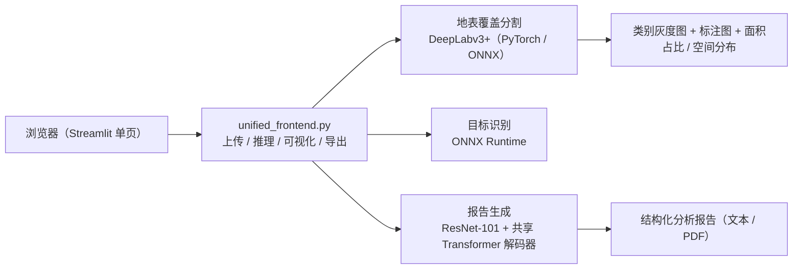

# RSIAP · 遥感影像智能分析平台

> 遥感影像「分割 → 识别 → 报告」一体化分析平台（校企合作项目开源版）

<p>
  
  
  
  
  
</p>

---

## 目录

- [项目简介](#项目简介)
- [系统架构](#系统架构)
- [三大模块](#三大模块)
- [分割模型指标](#分割模型指标)
- [目录结构](#目录结构)
- [快速开始](#快速开始)
- [部署与打包](#部署与打包)
- [说明与许可](#说明与许可)

---

## 项目简介

RSIAP 面向高分辨率遥感影像的地表覆盖分析：输入一张遥感影像，自动输出 **像素级地表覆盖分类（7 类）**、**类别统计** 与 **结构化分析报告**，并在统一的 Streamlit 界面中完成上传、对比、可视化与导出。

典型场景：农田与地表覆盖核查、水体/裸地监测、区域地物占比统计、遥感分析报告自动生成。

---

## 系统架构



---

## 三大模块

| 模块 | 能力 | 实现 |
|---|---|---|
| **地表覆盖分割** | 7 类地物像素级分类、类别灰度图、彩色标注图、面积占比与空间分布统计 | DeepLabv3+：ResNet 骨干 + 空洞卷积（output stride 16）+ ASPP（1×1、rate 6/12/18、全局池化）+ 解码器融合浅层特征 |
| **目标识别** | ONNX 推理，自动适配输入尺寸，支持 CPU / CUDA provider | onnxruntime，命令行与前端两种入口 |
| **报告生成** | 按模块（Global / Detailed / Abnormality / Conclusion）生成遥感分析文本 | ResNet-101 编码器 + 共享 Transformer 解码器，Prompt Token 控制生成模块 |

**分割 7 类**：`urban_land` / `agriculture_land` / `rangeland` / `forest_land` / `water` / `barren_land` / `unknown`

---

## 分割模型指标

DeepGlobe 数据集（训练 803 / 验证 171 / 测试 172，513×513 输入）：

| 指标 | 数值 |
|---|---|
| Pixel Accuracy（PA） | **86.18%** |
| Mean IoU（mIoU） | **60.54%** |
| Frequency Weighted IoU（FW-IoU） | **76.60%** |

训练配置：PyTorch 2.5.1、RTX 4060 Laptop、Batch 4 × 梯度累积 8、Adam、CrossEntropyLoss、50 epoch。

改进方向：田埂等小目标与类别不平衡是主要瓶颈 → Focal Loss、几何增强、滑窗高分辨率推理。

---

## 目录结构

```
RSIAP/
├── unified_frontend.py              # Streamlit 主界面：上传 / 推理 / 对比 / 导出
├── run_unified_frontend.bat         # Windows 启动器：找 runtime、选端口、拉起服务
├── segmentation_pytorch/            # 分割模块
│   ├── network/                     # DeepLabv3+ 网络（modeling / _deeplab / backbone）
│   ├── tools/segmentation_infer_cli.py   # 命令行单图推理
│   └── utils/                       # 数据变换、损失、调度器、可视化
├── recognition_onnx/                # 目标识别（ONNX Runtime）
│   └── app_tools/onnx_infer_cli.py  # 命令行推理
├── report_generator/                # 报告生成模块
│   ├── models/                      # encoder / decoder_transformer / transformer_model
│   └── weights/vocab.json           # 词表（模型权重未包含）
└── LICENSE                          # GPL-3.0
```

---

## 快速开始

### 方式一：内置 runtime（原交付方式，免环境配置）

将打包好的 `runtime\python` 放在项目根目录，双击 `run_unified_frontend.bat`：

1. 自动查找 `runtime\python\python.exe` 并配置 PATH / 编码；
2. 自动选择 8501–8510 中的空闲端口；
3. 无头模式启动 Streamlit，端口就绪后自动打开浏览器。

> 仓库**不包含** `runtime/` 目录（内置 Python 体积较大），需要按「部署与打包」自行制作。

### 方式二：手动安装依赖

```bash
pip install torch torchvision onnxruntime streamlit opencv-python numpy pillow fpdf2 tqdm
python -m streamlit run unified_frontend.py
```

> 需要将训练好的分割 / 识别 / 报告权重放到对应目录后使用（权重未随仓库提供）。

---

## 部署与打包

- **启动器逻辑**：优先检测 `runtime\python` → 设置 `PYTHONUTF8` / `STREAMLIT_BROWSER_GATHER_USAGE_STATS` → 端口探测（8501–8510）→ `streamlit run` 无头启动 → 轮询端口并自动打开浏览器。
- **内置 runtime 制作**：把 Python 3.10 环境（含 torch / onnxruntime / streamlit / opencv）复制到 `runtime\python`，即可在目标机器上免安装运行；路径不要含中文与空格。
- **权重与数据**：分割权重、识别模型、报告生成权重与原始遥感数据均不包含在本仓库中。

---

## 说明与许可

- 本仓库为校企合作项目的**代码整理版**，不包含原始遥感数据、训练权重与客户资料。
- 许可：根目录 `LICENSE` 为 **GPL-3.0**；`segmentation_pytorch/` 遵循其自带 **MIT** 许可（Copyright (c) 2020 Gongfan Fang）；其余第三方组件保留各自原始许可。
- 仅用于学习与技术交流，商用前请先获得项目相关方授权。
